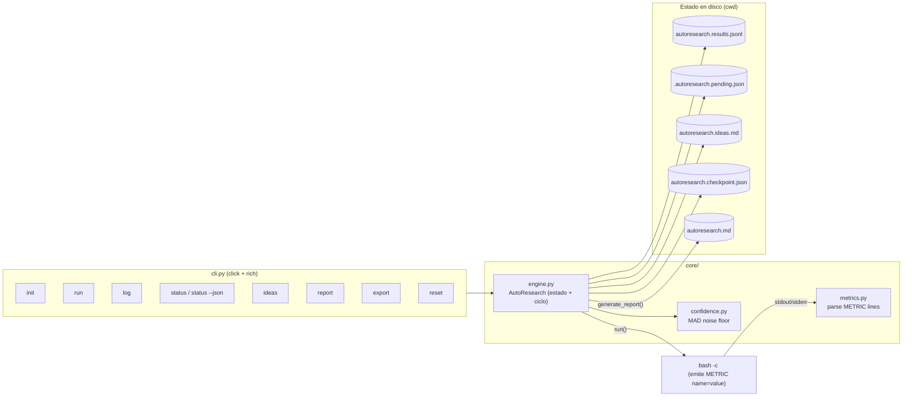

# Arquitectura — AutoResearch SDK

## Descripción general

AutoResearch es un SDK Python standalone para bucles autónomos de experimentación
(inspirado en karpathy/autoresearch y en el plugin AutoResearch de OpenClaw).
Su ciclo nuclear es un bucle PDCA encarnado en comandos:

```
SCAN → HYPOTHESIS → EXPERIMENT → MEASURE → INTEGRATE → repeat
       (Plan)        (Do)         (Check)    (Act)
```

- **Stack**: Python ≥3.10, `click` (CLI), `rich` (salida), pytest/ruff (dev).
- **Cero dependencias pesadas**: el motor es stdlib puro; click+rich solo para CLI.
- **Persistencia**: JSONL append-only (`autoresearch.results.jsonl`) compatible con
  el plugin AutoResearch de OpenClaw.

## Diagrama de componentes



## Modelo de datos

Entrada de configuración (una por segmento, se reescribe al hacer `init`):

```json
{"type": "config", "name": "...", "metricName": "...", "metricUnit": "...", "bestDirection": "lower|higher"}
```

Entrada de run (append por cada `log()`):

```json
{"run": 1, "commit": "abc1234", "metric": 142.5, "metrics": {"latency_ms": 142.5},
 "status": "keep|discard|crash|pending", "baseline": true, "description": "...",
 "timestamp": 1713888000, "segment": 0, "confidence": null}
```

Al reiniciar (`AutoResearch(cwd=...)`), el estado completo se reconstruye desde el
JSONL: config → segmento; runs → baseline/best/confidence. El fichero
`.autoresearch.pending.json` persiste un run ejecutado pero sin `log()` entre
procesos distintos de la CLI.

## Confianza estadística

`compute_confidence()` usa la Mediana de las Desviaciones Absolutas (MAD) como
suelo de ruido: `confidence = |best − baseline| / MAD` sobre runs con métrica > 0.
Umbral ≥2.0x = mejora probablemente real. Requiere ≥3 runs y MAD > 0.

## Fortalezas

1. **Simplicidad radical**: un solo concepto (run), tres estados (keep/discard/crash),
   un fichero de verdad (JSONL). Fácil de adoptar por cualquier agente.
2. **Funciones puras** para lo estadístico (`compute_confidence`, `parse_metric_lines`):
   testables sin I/O.
3. **Persistencia append-only** auditable y compatible con el ecosistema OpenClaw
   (83+ runs reales en producción en `~/.openclaw/autoresearch.jsonl`).
4. **Resistencia a fallos**: crash del benchmark no rompe el estado; el pending
   sobrevive entre invocaciones de CLI.

## Defectos encontrados (review 2026-10-27)

### Corregidos en 1.2.0

| ID | Defecto | Evidencia | Fix |
|----|---------|-----------|-----|
| D-1 | `log(status=...)` sin descripción ignoraba el status: un run descartado se registraba como `keep` y contaminaba `best_metric` | test `test_log_honors_status_without_description` (RED antes del fix) | Resolución unificada de status en `log()` |
| D-2 | Config sin nombre (`{"name": null}`) no restauraba metricName/direction del fichero: los argumentos del constructor ganaban silenciosamente y podían invertir el significado de "best" | test `test_unnamed_experiment_resumes_config_from_file` | Restaurar config del fichero independientemente del nombre |
| D-3 | `ExecutionResult.tail_output` era `@property` con parámetro `lines` inutilizable (`result.tail_output(40)` → TypeError) | ruff PLR0206 | Convertido a método |
| D-4 | Ideas duplicadas: el mismo fallo aprendido dos veces ensuciaba el backlog | test `test_duplicate_ideas_appended_once` | Dedup exacto al añadir |

### Pendientes (ver roadmap)

| ID | Defecto / deuda | Impacto |
|----|-----------------|---------|
| P-1 | Sin identidad de agente en el schema ni locking: dos agentes en el mismo cwd se pisan el pending (evidencia real: run #81 del plugin — flush de un pending ajeno "not mine" para desbloquearse) | Contención multi-agente |
| P-2 | Checkpoint `autoresearch.checkpoint.json` es write-only (nunca se lee); el del plugin OpenClaw tiene schema más rico (version, sessionStartCommit, carryForwardContext) y timestamps en ms | Estado duplicado divergente |
| P-3 | Run que pasa sin emitir `METRIC` se registra con métrica 0 silenciosamente (los crashes reales también usan 0; imposible distinguirlos) | Datos ruidosos |
| P-4 | `files_in_scope` / `off_limits` / `constraints` / `secondary_metrics` existen en el config pero no se serializan ni se aplican | Deuda de features declarativas |
| P-5 | Extras `git` y `mcp` declarados en pyproject sin código que los use | Empaquetado aspiracional |
| P-6 | `get_best_run()` devuelve un run descartado si ninguno se mantuvo | Semántica discutible |

## Decisiones técnicas (ADRs condensados)

- **ADR-1 — JSONL append-only como fuente de verdad**: elegido sobre SQLite/JSON
  único por compatibilidad con el plugin OpenClaw y auditabilidad línea a línea.
  Consecuencia: reconstrucción O(n) al iniciar (aceptable: decenas/cientos de runs).
- **ADR-2 — Estado en el cwd, no en un directorio global**: cada experimento vive con
  su repositorio. Consecuencia: imposible listar experimentos globalmente (deuda P-1
  del roadmap lo aborda con un registry opcional).
- **ADR-3 — Ejecución vía `bash -c` con captura de exit code**: el benchmark es una
  caja negra que emite `METRIC name=value`. Límite de confianza deliberado: el comando
  corre con los privilegios del usuario (superficie de confianza documentada).
- **ADR-4 — MAD sobre desviación estándar**: robustez frente a outliers con pocos
  runs, mismo algoritmo que el plugin OpenClaw.

## Estructura de directorios

```
alfred-autoresearch/
├── src/autoresearch/
│   ├── __init__.py        # API pública (AutoResearch, compute_confidence, ...)
│   ├── cli.py             # CLI click: init/run/log/status/ideas/report/export/reset
│   └── core/
│       ├── engine.py      # Motor: estado, ciclo run→log, persistencia, report
│       ├── confidence.py  # MAD noise floor + descripción humana
│       └── metrics.py     # Parser METRIC name=value
├── tests/
│   ├── test_autoresearch.py  # Motor, confianza, métricas, ideas, report
│   └── test_cli.py           # CLI end-to-end (CliRunner)
├── docs/                  # arquitectura.md, roadmap.md, manual_usuario.md
├── CHANGELOG.md
└── pyproject.toml
```
